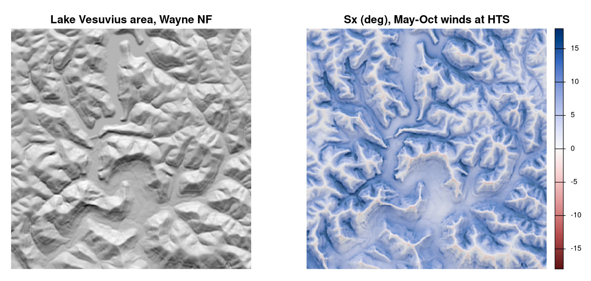

# leeward

<!-- badges: start -->
[](https://github.com/Leewardbit/leeward/actions/workflows/R-CMD-check.yaml)
<!-- badges: end -->

> Find sheltered, flat, legal, well-drained places to camp, built on a
> transparent, well-documented terrain wind exposure model.

**Status:** early development. v0.1.0 (wind exposure) is released. The
development version adds v0.2 terrain and water layers: `flatness_score()`,
`aspect_score()`, `water_distance()`, `water_score()`,
`water_exclusion()`, and DEM-derived channels: `contributing_area()`,
`height_above_channel()`, and `channel_exclusion()`. It also adds the first v0.3
pieces: `shelter_score()`, `drainage_score()`, `flood_exclusion()`,
`canopy_score()`, `land_exclusion()`, `camp_suitability()`, and
`candidate_areas()`. Run `help(package = "leeward")` or `?leeward` for an
overview.

## What it does

1. **Wind exposure (v0.1).** Computes terrain-based exposure from a DEM and a
   local wind climatology: the Winstral *Sx* upwind-slope index, combined
   across directions weighted by frequency. `topex()` is a
   distance-limited TOPEX alternative that needs no wind record.
2. **Terrain and water (v0.2).** 0–1 scores for flatness, aspect, and
   water access, plus hard exclusion masks for the water setback and for
   low ground along channels derived from the DEM (height above the
   nearest drainage), which also covers unmapped hollows.
   Scores trade off against each other in a weighted sum. Exclusions
   are rules no weighting can override.
3. **Suitability (v0.3, in progress).** `camp_suitability()` combines the
   scores with explicit weights (there are no defaults) and applies every
   exclusion as a hard rule. `candidate_areas()` ranks the best patches as
   polygons: candidate areas to scout. `land_exclusion()` turns your own
   land-status polygons into an exclusion. `drainage_score()` and
   `flood_exclusion()` use SSURGO soils, and `canopy_score()` uses tree
   canopy cover.

## Example

```r
library(leeward)

dem <- terra::rast(system.file("extdata", "vesuvius_dem.tif", package = "leeward"))
wind <- read.csv(system.file("extdata", "hts_wind.csv", package = "leeward"))

freq <- wind_direction_freq(wind$drct[wind$month %in% 5:10], n_sectors = 16)
sx <- wind_exposure(dem, freq, max_dist = 300)
terra::plot(sx)
```



Positive Sx (blue) means terrain rises upwind, so the cell is sheltered from
the prevailing May–October winds. Negative Sx (red) marks exposed ridgelines. Cells within
`max_dist` of the DEM edge are `NA` and trimmed from the map.

### Example data

The DEM and wind files are built by `data-raw/wayne_vesuvius.R`.

- `vesuvius_dem.tif`: a 4 × 4 km area around Lake Vesuvius Recreation Area,
  Ironton Ranger District, Wayne National Forest, Ohio, at 10 m in UTM 17N
  (EPSG:32617). From AWS Terrain Tiles via elevatr (USGS 3DEP and other sources;
  see the [Terrain Tiles attribution](https://github.com/tilezen/joerd/blob/master/docs/attribution.md)).
- `hts_wind.csv`: routine hourly observations from the Huntington, WV ASOS
  station (HTS), about 25 km away, covering 2021–2025 with calms removed. Columns are `month`, `drct`
  (degrees from) and `sknt` (knots). From the Iowa Environmental Mesonet via
  riem.
- `vesuvius_water.gpkg`: high-resolution NHD flowlines (layer
  `flowlines`, with `flow` = perennial or intermittent) and waterbodies
  (layer `waterbodies`) for the same area, from the USGS National Map
  (public domain). Built by `data-raw/vesuvius_water.R`. Many small
  side hollows have no mapped channel, though they may carry ephemeral
  flow; `height_above_channel()` finds them from the DEM.
- `vesuvius_soils.gpkg`: SSURGO soil map units (layer `mapunits`) with
  drainage class and flooding frequency from the `muaggatt` table, from the
  USDA-NRCS Soil Data Access service (public domain). Built by
  `data-raw/vesuvius_soils_canopy.R`.
- `vesuvius_canopy.tif`: NLCD Tree Canopy Cover 2021 (v2021-4), percent,
  30 m, reprojected to UTM 17N with nearest neighbor. USDA Forest Service
  (2023), usable without permission or fees. Built by the same script.
- `ridge.tif`: a synthetic ridge used in function examples.

## Direction convention

Degrees, the direction the wind blows **from**, 0 = north, clockwise.

## Safety and legal framing

- Output marks **candidate areas to scout**, never "safe campsites".
- Sheltered terrain has hazards of its own: flash floods in drainages, cold-air
  pooling, and dead trees or widowmakers under canopy. Exposed ridges carry
  lightning risk.
- Camping rules vary by district and season, and fire restrictions change. The
  land-status layer is a user-supplied filter, **not** an authoritative
  source. Check with the managing agency.

## Related tools

leeward aims to be a lightweight, pure-R (terra) alternative, not a
duplicate:

- SAGA GIS Wind Effect / Wind Exposition Index (via Rsagacmd); RSAGA's
  `wind.shelter()` (Plattner et al. wind shelter index)
- ExposR: topographic exposure to hurricane winds
- windscape: landscape connectivity by wind
- openair (wind roses), extRemes (extreme winds), cffdrs (fire weather)
- ForestGALES: mechanistic windthrow risk (no current CRAN package found)

## License

MIT © Mark Oleson
